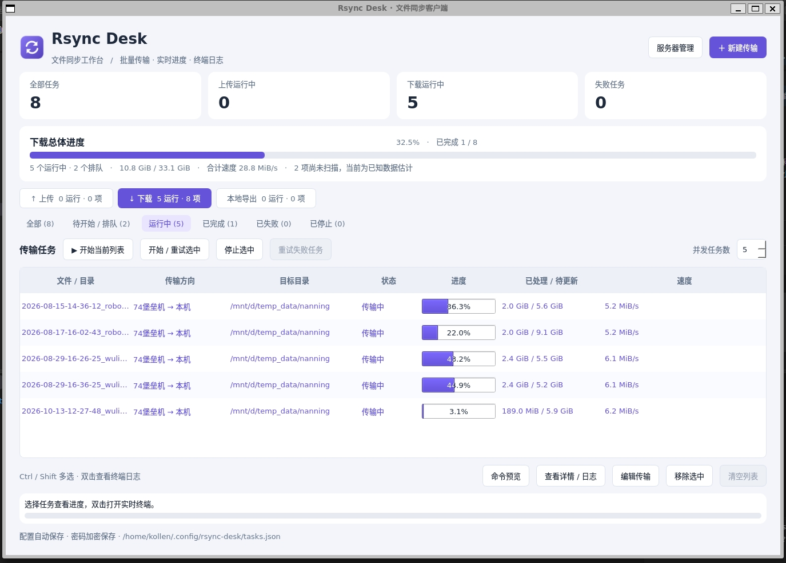

# Rsync Desk

使用 Python / PySide6（Qt Widgets）编写的中文桌面 rsync 客户端。批量选择文件和目录，导出到同一个本地目录，或通过 SSH 上传、下载。

# 软件截图



## 启动

需要 Python 3.10+、PySide6-Essentials、rsync 3.1+。远端同步还需要 OpenSSH 客户端和远端安装 rsync。

Ubuntu / Debian：

```bash
sudo apt install python3-venv rsync openssh-client libegl1 libxkbcommon-x11-0 libxcb-cursor0 libxcb-icccm4 libxcb-keysyms1 libxcb-render-util0 libxcb-shape0
python3 -m venv .venv
source .venv/bin/activate
pip install -r requirements.txt
python main.py
```

macOS：安装 Python 和新版 rsync；系统自带的旧版 rsync 不满足要求。例如使用 Homebrew 的 `python` 和 `rsync`，然后运行上面的虚拟环境与 Python 启动命令。

支持 Linux、macOS，以及带 WSLg / X11 的 WSL2。需要图形桌面；不支持直接在原生 Windows Python 中运行。

也可以安装为桌面命令：

```bash
pip install .
rsync-desk
```

## 使用

### 先保存和登录服务器

点击主窗口的“服务器管理”，新增服务器，填写名称、主机、SSH 端口、登录账号、密码或私钥以及初始目录。勾选“加密保存密码”，首次保存时设置主密码；以后打开应用，输入一次主密码即可解锁本次会话。

“保存并登录”会实际认证并检查远端是否可以运行 rsync。服务器列表支持编辑、登录测试、断开和删除，展示登录状态和失败原因。登录连接用于浏览远端文件，传输任务使用同一份服务器配置建立自己的 rsync / SSH 连接。

支持两种连接方式，也可组合使用：

- **堡垒机复合账号**：主机填写堡垒机地址，账号可以包含多个 `@`，例如 `zhangxiaoquan@root@10.44.119.74`，端口按堡垒机配置填写。应用用 `ssh -l` 单独传递账号，避免与主机混淆。堡垒机需要允许 SSH exec、TCP 转发或 SFTP 中相应的服务；仅提供交互式菜单的堡垒机无法直接运行 rsync。
- **SSH 跳板机**：先保存跳板机，再在目标服务器的“通过跳板机”下拉框中选择它。每一跳可使用自己的账号、端口、密码或密钥。支持多级跳板机，自动拒绝循环引用。

### 新建传输只选来源和目标

1. 点击“新建传输”。
2. 在“从哪里传输”和“传输到哪里”中选择“本机”或已保存的服务器。来源是远端时，目标只提供本机；来源是本机时，目标可以是本机或服务器。可以交换两端。
3. 点击“选择文件 / 目录”。本机和远端都支持 Ctrl / Shift 混合多选文件与目录、双击进入目录、跨目录加入待选。也可以手动输入绝对路径，每行一项。
4. 点击目标的“浏览目录”选择本机或远端目录，也可以直接输入路径。
5. 点击“预览传输命令”，可切换查看实际传输和预扫描命令，并复制完整语句。预览不执行命令、不需要解锁密码；密码不会出现在语句中。
6. 添加任务后，在对应分类点击“开始当前列表”，或多选后“开始 / 重试选中”。并发数 1–8，默认 2。
7. 单行显示该文件或目录的总体进度、大小、速度和状态。选中任务后也可以点击“命令预览”；双击打开独立详情窗口，查看源/目标、当前条目、ETA、用时和终端日志。

每个选中的源文件或目录是一条独立任务，**每条任务先执行一次预扫描，再执行一条实际 rsync 命令**。批量选择多个目录会生成多条任务，方便分别显示进度、停止与重试。目录内部的文件在同一条 rsync 命令中同步。

例如同时选中 `/data/photos` 和 `/data/report.pdf`，目标为 `/backup`，生成两条任务，分别写入 `/backup/photos/` 和 `/backup/report.pdf`。同名源需要拆分到不同目标目录，或勾选“内容直传”合并。

### 远端互同步与内容直传

- **远端互同步**：新建传输时，“从哪里传输”和“传输到哪里”选择**同一台服务器**，即可在该服务器内部两个目录之间同步。rsync 直接在服务器上执行，数据不经本机中转，速度取决于服务器磁盘而非本机带宽。运行中停止会同时终止服务器上的 rsync 进程。远端需要安装 rsync；未安装时任务会失败并给出明确提示。
- **内容直传**：勾选后把源目录的**内容**直接同步到目标目录，不再套一层源目录（等价于 rsync 源路径尾斜杠语义）。例如 `/data/logs` 内容直传到 `/backup`，结果为 `/backup/xx.log` 而非 `/backup/logs/xx.log`。四种方向均支持；勾选后允许同名目录合并写入。

### 任务列表与进度

任务列表按“上传 / 下载 / 本地同步 / 远端互同步”四个方向分页签，各方向内再按状态分类。列表展示进度、已处理/待更新、速度和**剩余时间**；顶部总体进度只统计本次运行的任务批次，启动任务后自动跳转到“运行中”页签。

仅支持本机与远端之间的上传、下载、本地同步，以及同一服务器内部的远端互同步；不提供两台不同服务器之间的直接传输。跳板机负责建立连接，不作为第二个传输端点。

远端目录浏览继续使用 SFTP，SSH 和 SFTP 通道均会复用。采用批量预读并分批显示，不逐个读取链接属性；只有打开链接时才解析。最近访问的目录缓存 15 秒，“刷新”会绕过缓存。退出目录或关闭选择窗口会取消旧读取。文件传输仍由 rsync 执行。

## 上传与下载任务列表

上传、下载分别显示在独立页签中，本地同步和远端互同步保留单独入口。各方向提供“全部”“待开始 / 排队”“运行中”“已完成”“已失败”“已停止”分类和数量。顶部显示上传、下载各自运行中的数量，当前方向的总体进度和速度也独立统计，且只统计本次运行中的任务。

- “运行中”包含扫描、传输及正在停止的任务；排队任务单独计数。
- “开始当前列表”、选中任务操作、重试失败任务和“清空列表”只作用于当前方向和当前分类，不影响另一侧。
- “重试失败任务”批量重试当前列表中的失败项，并回到该方向的“全部”查看新进度。
- “清空列表”移除当前列表中的非活动任务记录，不删除文件；运行中、正在停止及排队的任务保留，需要时先停止后再清空。
- 完成、失败和停止的记录及最终统计自动保存，重启后保留分类。上次会话尚在运行或排队的任务标记为“已停止”，不会自动启动。再次执行会重新扫描。终端日志仍只在当前会话保留。

## 进度和同步行为

- 每条任务先通过 `rsync --dry-run --stats` 计算本次需更新文件的逻辑大小，然后以 `--info=progress2` 报告进度。目录任务进度汇总该目录中的文件，单文件任务显示自身进度。
- 顶部按任务数据量加权汇总进度，同时显示完成任务数。还有未扫描的任务时会标明“已知数据估计”；这些任务扫描完毕后，总大小与比例会调整。扫描期间源数据变化也会影响总大小。
- 显示的速度和字节数是 rsync 的逻辑文件处理量；压缩或增量更新时，与实际网络流量不同。只有 rsync 成功退出才显示 100%；失败或停止不会显示为完成。
- 文件按大小和修改时间执行 rsync 默认增量判断。保留目录结构、符号链接、修改时间；使用 `-rlt`，不复制所有者、组、设备节点或完整权限。
- 自动创建缺失的本地目标目录。目标中的已有同名文件可能被更新，不删除目标中的其他文件。
- “停止”会终止当前任务的 rsync / SSH 进程组；再次开始会重新扫描。部分数据保存在 rsync 的 `.rsync-partial` 目录，远端增量重试时可重复利用。
- 写入同一目标文件或目录的任务会串行执行，避免同时写入。
- 支持单任务 KiB/s 限速、远端压缩及分号分隔的排除规则，例如 `.git;__pycache__;*.tmp`。
- 日志在会话内保存最近 10,000 行。需要长期留存时请使用“导出日志”。重新打开应用时保留任务定义及最终状态、统计，重新执行时扫描进度，终端日志不跨会话恢复。

## 账号密码保存

旧版任务配置在读取时自动迁移：连接信息归入服务器列表，任务引用对应服务器，保留原密码库引用。

默认配置目录：`~/.config/rsync-desk/`，也遵循 `XDG_CONFIG_HOME`。

| 文件 | 内容 |
| --- | --- |
| `tasks.json` | 独立的服务器列表（账号、端口、跳板机、密码引用）和引用服务器的任务列表、任务状态与最终统计，不含明文密码 |
| `credentials.enc` | AES-256-GCM 加密密码库，PBKDF2-HMAC-SHA256（600,000 次）派生密钥 |

配置和密码库以 `0600` 权限原子写入。主密码不写入磁盘；应用退出时清除解锁状态。主密码无法找回，建议备份上述两个文件并妥善保存主密码。服务器中取消“加密保存密码”会解绑该服务器的密码引用，已存在的密码库条目不会自动删除。

rsync 的 SSH 登录通过私有 Unix socket 和 `SSH_ASKPASS` 按连接身份提供各跳密码，不放入命令行、环境变量或临时文件内容。日志会遮盖当前密码。首次连接采用 `StrictHostKeyChecking=accept-new`，主机密钥记录到 OpenSSH 的 `known_hosts`，之后密钥变化会拒绝连接。

需要其他配置位置时：

```bash
python -m rsync_client --config /path/to/config/tasks.json
```

密码库保存在指定配置文件同目录。使用带密码的私钥时，请先用 `ssh-add` 加入 SSH agent；当前密码框用于远端登录密码。

## 界面与打包约定

界面已迁移至 PySide6，使用 `PySide6-Essentials`；应用代码只直接导入 `QtCore`、`QtGui`、`QtWidgets`，`QtTest` 仅用于测试。Essentials 安装包仍带有部分其他 Qt 库，后续发布时按实际依赖裁剪，不直接删除开发环境中的 Qt 文件。

Ubuntu 20.04 x86_64 发行版使用 **Nuitka** 构建，剔除未使用的 Qt 模块、插件和测试工具。安装包和便携包在 [GitHub Releases](https://github.com/KollenHub/rsync-client/releases) 发布，构建与安装方式见 [打包说明](docs/packaging.md)。Ubuntu 20.04 构建单独固定兼容的 PySide6 6.8.3 和 Python 3.11.18，不使用开发环境的新版 Qt wheel。

## 验证

```bash
.venv/bin/python -m unittest discover -v
```

测试覆盖真实 rsync 文件/目录传输、中文和特殊字符路径、空目录/文件、增量重跑、取消重试、并发限制、相同目标串行、错误退出、密码遮盖、密码库跨会话读取、错误主密码和密文篡改检测。GUI 测试使用 PySide6.QtTest 和 offscreen 平台，不依赖图形显示。测试还覆盖服务器独立保存、旧任务连接迁移、跳板机循环检测、单级/两级跳板机真实传输、复合账号、登录后浏览远端目录和命令预览。

运行全部测试（含 GUI 和本机 SSH 测试服务）：

```bash
pip install -r requirements-dev.txt
QT_QPA_PLATFORM=offscreen .venv/bin/python -m unittest discover -v
.venv/bin/ruff check rsync_client tests main.py
```

协议选项参考 [rsync 官方手册](https://download.samba.org/pub/rsync/rsync.1) 和 [OpenSSH 手册](https://man.openbsd.org/ssh.1)。
